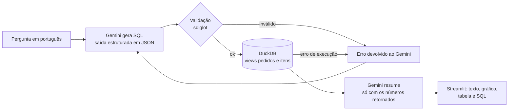

# Copiloto de KPIs Logísticos

Assistente que responde perguntas de operações em português ("quais regiões mais atrasaram em março?") gerando SQL com o Gemini (plano gratuito), validando a consulta e devolvendo **resposta em texto + tabela + gráfico + o SQL usado**, para que gestores sem conhecimento técnico consultem os dados de entrega sem depender do time de dados.

Construído sobre o [dataset público de e-commerce brasileiro da Olist](https://www.kaggle.com/datasets/olistbr/brazilian-ecommerce) (~100 mil pedidos de 2016 a 2018).

## O problema

Em operações logísticas, a maioria das perguntas do dia a dia ("o atraso piorou este mês?", "qual estado tem o pior prazo?") vira um pedido para alguém escrever SQL. O copiloto reduz esse ciclo de horas para segundos, sem abrir mão de transparência: toda resposta mostra exatamente como foi calculada.

## Como funciona



1. **Camada semântica** (`src/copiloto/db.py`): os 7 CSVs da Olist viram duas views com nomes em português e KPIs prontos (`dias_entrega`, `dias_atraso`, `atrasado`, `regiao_cliente`, `nota_avaliacao`). O LLM só enxerga essas views, o que reduz erros de join e de interpretação.
2. **Geração de SQL** (`src/copiloto/copiloto.py`): o Gemini recebe o schema e regras de negócio (ex.: atraso só conta pedidos entregues) e responde em JSON validado por um schema Pydantic (`sql` + `explicacao`), garantindo saída estruturada.
3. **Validação** (`src/copiloto/sql_guard.py`): parse com sqlglot; só passa um único `SELECT/WITH` sobre `pedidos` e `itens`, sem funções que leem arquivos ou variáveis de ambiente.
4. **Autocorreção**: se a validação ou o DuckDB rejeitar a consulta, o erro volta ao Gemini, com até 3 tentativas.
5. **Resumo**: uma segunda chamada escreve 2 ou 3 frases usando apenas os números do resultado.

### Segurança

- Duas camadas: o validador de SQL **e** o próprio DuckDB, que depois de carregar os dados roda com `enable_external_access = false` e configuração travada. Mesmo que uma consulta maliciosa passasse pelo validador, o banco não leria nem gravaria arquivos.
- Resultado limitado a 1.000 linhas; só as 50 primeiras vão para o resumo.
- A chave da API fica no `.env`, fora do repositório.
- O LLM nunca recebe a base inteira: só o schema, a pergunta e até 50 linhas do resultado.

## Como rodar

```bash
python -m venv .venv && source .venv/bin/activate   # Windows: .venv\Scripts\activate
pip install -r requirements.txt
cp .env.example .env                                  # e coloque sua GEMINI_API_KEY
```

### Chave do Gemini (gratuita)

Crie uma chave em [Google AI Studio](https://aistudio.google.com/apikey), sem cartão de crédito, e coloque no `.env`. O modelo padrão é o `gemini-3.8-flash`. O plano gratuito limita requisições por minuto e por dia; cada pergunta usa pelo menos 2 chamadas (SQL + resumo). Quando o limite é atingido, o copiloto espera e tenta de novo. Se o limite apertar, troque para `gemini-3.5-flash-lite` no `.env`. No plano gratuito, o Google pode usar as requisições para melhorar seus produtos; como os dados aqui são públicos, isso não é um problema.

### Dados

**Dataset real (recomendado):** baixe o zip no [Kaggle](https://www.kaggle.com/datasets/olistbr/brazilian-ecommerce) e extraia os CSVs em `data/olist/`.

**Amostra sintética (para testar rápido):** gera CSVs no mesmo formato, com números inventados.

```bash
python scripts/gerar_amostra.py data/amostra
# e no .env: COPILOTO_DADOS=data/amostra
```

### App

```bash
streamlit run app.py
```

### Testes

```bash
pytest -q
```

Os testes cobrem as views (uma linha por pedido, coerência dos KPIs de atraso), o validador (aceita leituras, bloqueia `DROP`, `COPY`, `ATTACH`, `read_csv`, `getenv`, múltiplos comandos) e o pipeline com um cliente falso do Gemini (caminho feliz, autocorreção após erro, desistência após o limite e espera quando o limite do plano gratuito é atingido). Rodam sem chave de API.

## Perguntas de exemplo

- Quais regiões têm o maior percentual de pedidos atrasados?
- Como evoluiu o percentual de atraso mês a mês?
- Qual o tempo médio de entrega por estado no Nordeste?
- Pedidos atrasados recebem notas piores? Compare a nota média.
- Quais categorias têm o frete mais caro em relação ao preço?

## Próximos passos

- Rodar sobre o **BigQuery**: as views usam SQL padrão; basta trocar a conexão e o dialeto do sqlglot para `bigquery`.
- Conjunto de avaliação com perguntas e respostas esperadas para medir a acurácia do SQL gerado a cada mudança de prompt.
- Memória de conversa para perguntas de acompanhamento ("e só no Sudeste?").

## Stack

Python · Gemini API (google-genai) · DuckDB · sqlglot · Streamlit · Altair · pytest

---

Dados: Olist, Brazilian E-Commerce Public Dataset, licença CC BY-NC-SA 4.0. Projeto de portfólio, sem fins comerciais.
